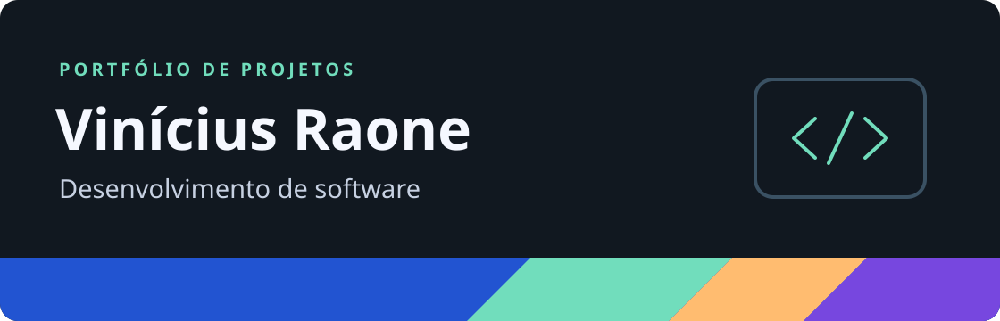

Estudo desenvolvimento de software e gosto de transformar regras de um problema em sistemas que dá para usar. Aqui estão alguns projetos acadêmicos em que pratiquei modelagem, lógica e desenvolvimento de interfaces.

## Formação

- **Orientação a Objetos** — Trabalho final em Python com modelagem de usuários, acervo e empréstimos.
- **Desenvolvimento de Websites** — Projeto acadêmico em React com perfis de administrador e jogador.

## Habilidades

| Área | Experiência nos projetos |
| --- | --- |
| Linguagens | Python, JavaScript e TypeScript |
| Desenvolvimento | Orientação a objetos, separação de responsabilidades e implementação de regras de negócio |
| Interfaces e dados | React, HTML, CSS, JSON e persistência local |
| Ferramentas | Git, GitHub e Vite |

## Projetos em destaque

- **[Sistema de Biblioteca](https://github.com/Vinciusssss/sistemaBiblioteca)** — Aplicação em Python com perfis de cliente e bibliotecário, controle de acervo e empréstimos.
- **[Jogo Perfil](https://github.com/Vinciusssss/JogoPerfil)** — Jogo de adivinhação desenvolvido em dupla, com dicas, pontuação e recorde salvo no navegador. [Jogar no navegador](https://jogoperfilweb.vercel.app/)
- **[SupraBet](https://github.com/Vinciusssss/SupreBet)** — Simulador acadêmico com gestão de eventos, saldo fictício e conquistas.
